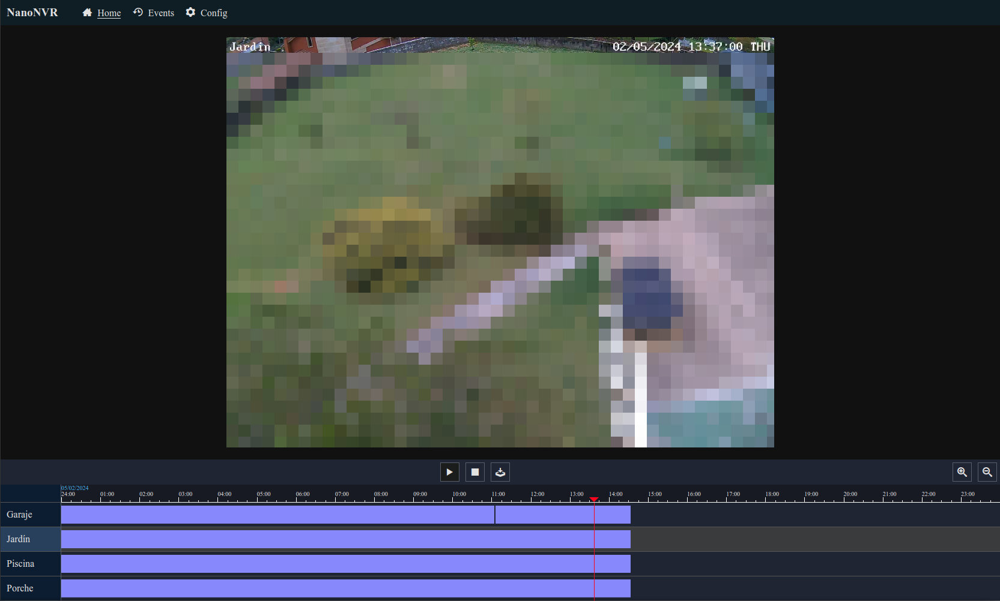

# NanoNVR

The tiniest NVR. Will not waste your CPU with unneeded bloat.
Let your camera do the work.



## Features

- Passthrough recording (RTSP, RTMP, HLS, SRT... anything [MediaMTX](https://github.com/bluenviron/mediamtx) can read)
- Camera Events

That's all! We will not implement transcoding, motion detection, or any other
advanced features that your camera should be doing instead.

Thanks to the limited features we provide, NanoNVR can run on lightweight
devices, such as a Raspberry, even if you're handling multiple 4k cameras.

## Usage

If you'd like to use NanoNVR on your Home Assistant instance, check our [addons](https://github.com/mancontr/nanonvr-hass-addons) page.
This is the recommended way to run the project.

You can also run it through [Docker](https://hub.docker.com/r/mancontr/nanonvr) directly, or as a standard Node project:

```sh
yarn
yarn start
```

When running it as a Node project, you'll need [MediaMTX](https://github.com/bluenviron/mediamtx/releases)
and [ffmpeg](https://ffmpeg.org/) on your `PATH` (or point `MEDIAMTX_BIN` to the MediaMTX binary).

MediaMTX listens only on localhost, on ports 18554 (RTSP), 18888 (HLS), 19996 (playback) and 19997 (API).
If any of those is taken, use `MEDIAMTX_RTSP_PORT`, `MEDIAMTX_HLS_PORT`, `MEDIAMTX_PLAYBACK_PORT` or `MEDIAMTX_API_PORT`.

As soon as it starts, it will print the address you can use to access the web interface.
